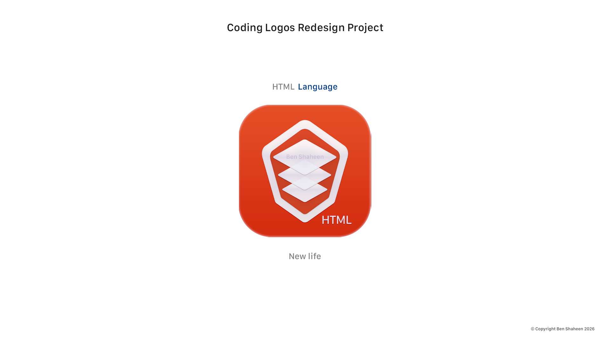
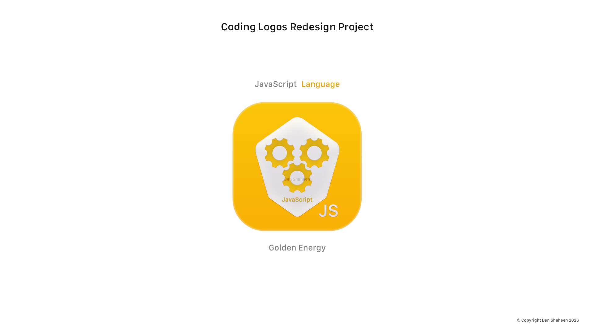

#  Code Logos Reimagined Welcome to my portfolio! Here, I redesign and reimagine famous programming languages and tech logos with a fresh, modern, and artistic touch. --- ###  The Gallery ###  HTML: New Life  --- ###  CSS: RebeccaPurple Tribute A premium design utilizing the iconic **RebeccaPurple** (`#663399`) color as a deep tribute to the web community. It blends strict structural geometry with smooth, futuristic purple gradients to represent the core of CSS: transforming raw web layouts into beautiful, elegant, and adaptive digital art.  --- ###  JavaScript: Golden Energy An energetic design with a vibrant golden gradient and a gear motif. It represents JavaScript as the living engine and interactive brain that drives the modern web.  ---  *Copyright Ben Shaheen 2026. All rights reserved.*
